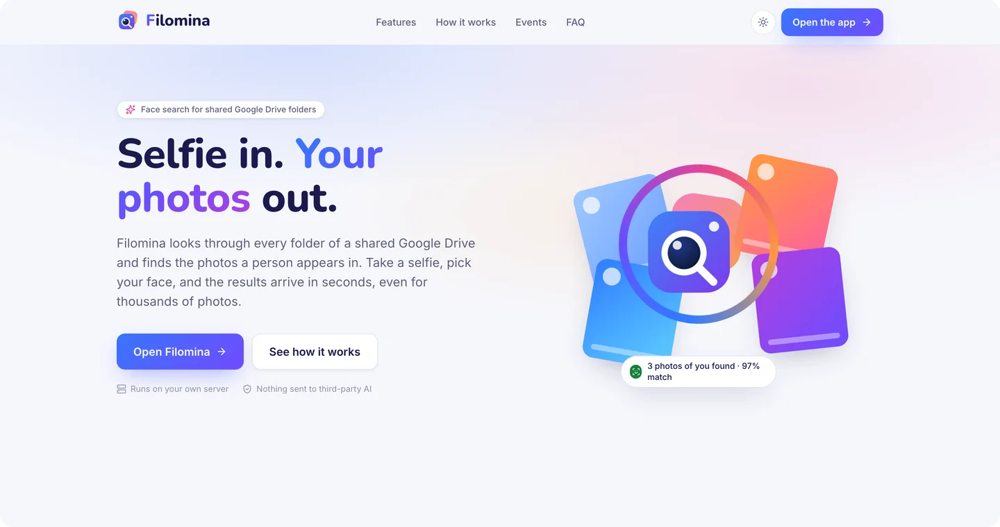
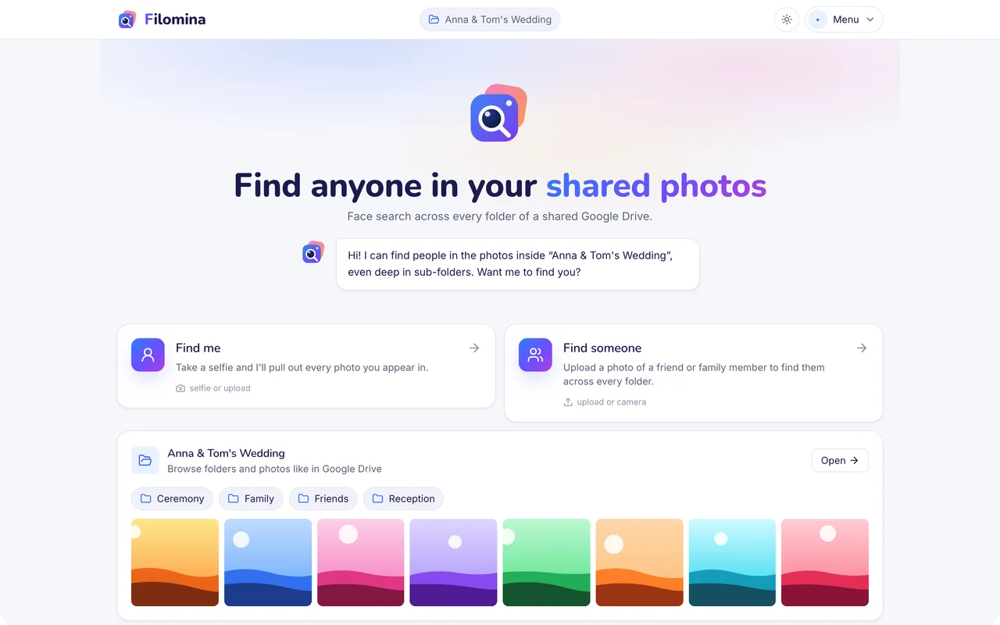
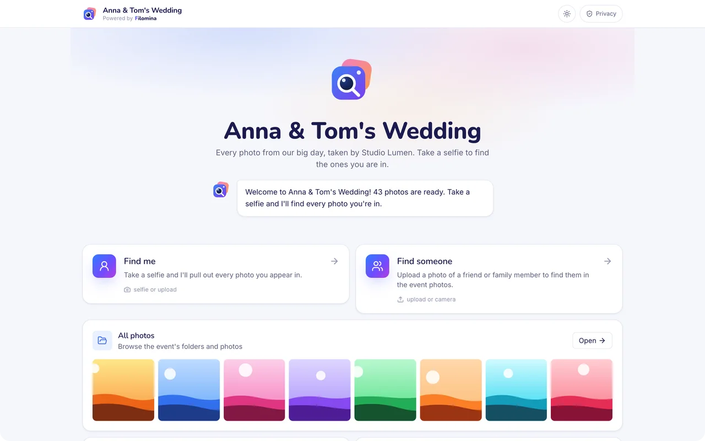
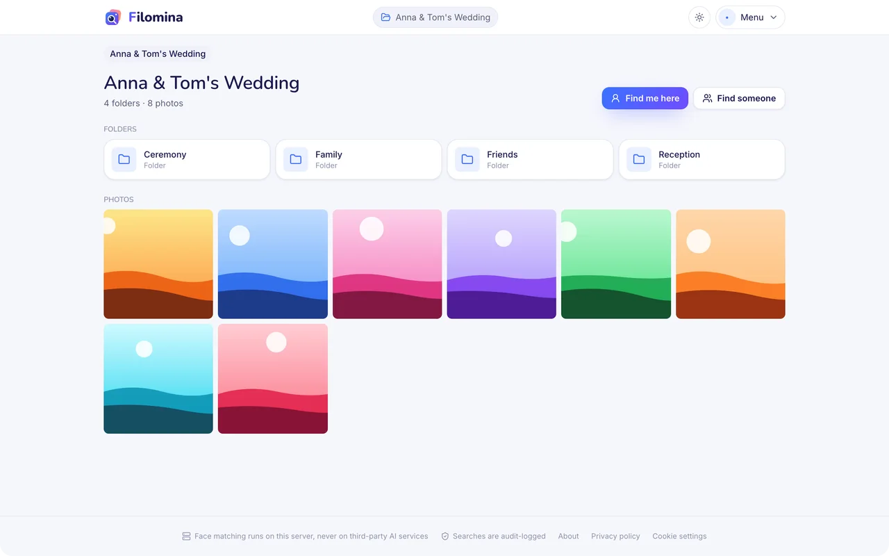
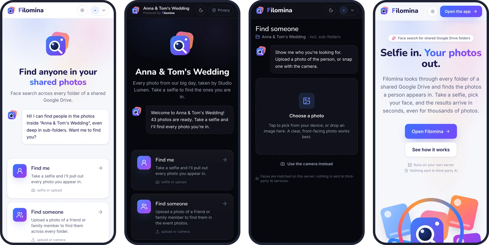
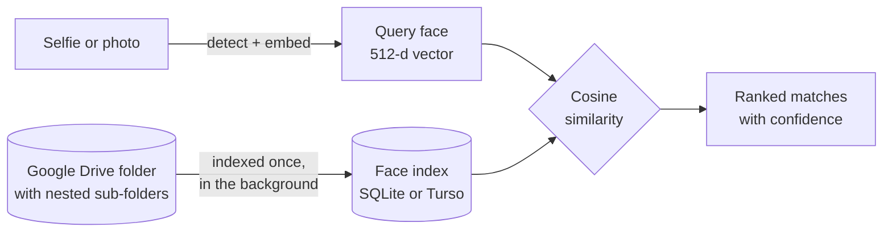

<div align="center">


<br />
<picture>
  <source media="(prefers-color-scheme: dark)" srcset="public/brand/wordmark-light.svg" />
  
</picture>

### Selfie in. Your photos out.

**AI face search for shared Google Drive folders.**<br />
Take a selfie, and Filomina finds every photo you appear in, across every nested folder, in seconds.

[](https://nextjs.org)
[](https://react.dev)
[](https://www.typescriptlang.org)
[](https://tailwindcss.com)
[](https://onnxruntime.ai)
[](Dockerfile)

[Features](#features) · [Screenshots](#screenshots) · [How it works](#how-it-works) · [Quick start](#quick-start) · [Events](#events-for-organisers) · [Deploy](#deployment) · [Privacy](#security-and-privacy)

<br />

<picture>
  <source media="(prefers-color-scheme: dark)" srcset="docs/screenshots/hero-dark.webp" />
  
</picture>

</div>

<br />

After a wedding, a school trip or a team offsite, the photos end up in one huge shared Drive folder. Nobody wants to scroll through two thousand pictures to find the thirty they are in. Filomina reads the whole folder tree, learns every face once, and lets anyone find their photos with a single selfie. Organisers can turn a folder into an event link that guests open on their phones, with no sign-in and no app to install.

## Features

<table>
  <tr>
    <td width="33%" valign="top">
      <h4>🤳 Find me in seconds</h4>
      Take a selfie or upload a photo. Matches are ranked by confidence, with the matched face highlighted.
    </td>
    <td width="33%" valign="top">
      <h4>🔗 One link per event</h4>
      Attach a Drive folder to an event, index it once, and share a private link. Guests search instantly.
    </td>
    <td width="33%" valign="top">
      <h4>📁 Built for Google Drive</h4>
      Public folders open without sign-in. Private folders use Google sign-in with read-only access.
    </td>
  </tr>
  <tr>
    <td valign="top">
      <h4>🎯 Accurate on real photos</h4>
      SCRFD finds small faces in group shots and ArcFace handles different angles. Mirrored selfies are handled automatically.
    </td>
    <td valign="top">
      <h4>⚡ Fast on large albums</h4>
      Photos are indexed in the background. A search compares one face with the index, and only new photos are ever analysed.
    </td>
    <td valign="top">
      <h4>🔒 Private by design</h4>
      Face recognition runs on your own server with open models. Nothing is sent to a third-party AI service.
    </td>
  </tr>
  <tr>
    <td valign="top">
      <h4>📱 Mobile first</h4>
      Front-camera capture, a face picker for group photos, and up to five reference photos for tricky angles.
    </td>
    <td valign="top">
      <h4>🌗 Light and dark</h4>
      A polished interface with smooth motion and a theme switch that remembers each visitor's choice.
    </td>
    <td valign="top">
      <h4>🧾 Consent and audit trail</h4>
      Visitors accept a clear privacy notice, and every search is logged for the operator. Entries expire automatically.
    </td>
  </tr>
</table>

## Screenshots

<table>
  <tr>
    <td width="50%">
      <picture>
        <source media="(prefers-color-scheme: dark)" srcset="docs/screenshots/home-dark.webp" />
        
      </picture>
      <p align="center"><sub>Home: your folder, ready to search</sub></p>
    </td>
    <td width="50%">
      <picture>
        <source media="(prefers-color-scheme: dark)" srcset="docs/screenshots/event-dark.webp" />
        
      </picture>
      <p align="center"><sub>Event page: what guests see from the shared link</sub></p>
    </td>
  </tr>
  <tr>
    <td colspan="2">
      <picture>
        <source media="(prefers-color-scheme: dark)" srcset="docs/screenshots/browse-dark.webp" />
        
      </picture>
      <p align="center"><sub>Browse folders and photos just like in Google Drive</sub></p>
    </td>
  </tr>
</table>

<p align="center">
  
  <br />
  <sub>Designed for phones first, in light and dark</sub>
</p>

## How it works



1. **Detect.** SCRFD finds every face and its five landmarks, including small faces in crowded group shots.
2. **Recognise.** Each face is aligned and turned into a 512-number ArcFace template. The query face is embedded twice, as taken and mirrored, and averaged so mirrored selfies match too.
3. **Index once.** Filomina walks the Drive folder tree and stores one template per face. Only templates are kept, never copies of the photos. Later runs only touch photos that are new or changed.
4. **Match.** A search compares your face with the index and streams results to the page as they are found. You can tighten or relax the match strictness afterwards without searching again.

Everything runs on the server you deploy, using [ONNX Runtime](https://onnxruntime.ai) and the [InsightFace](https://github.com/deepinsight/insightface) models.

## Quick start

**You need** Node.js 20.19 or newer and about 1 GB of free disk for the face models.

```bash
git clone https://github.com/khjabir/filomina.git
cd filomina
npm install
npm run fetch-models          # downloads the face models once (~280 MB)
cp .env.example .env.local    # then fill in the values, see below
npm run check-env             # validates your settings and tests your Google API key
npm run dev
```

Open http://localhost:3000.

> [!TIP]
> **No Google account handy?** Point Filomina at a folder of photos on your computer: set `DRIVE_LOCAL_DIR=/path/to/photos` in `.env.local`. Nested folders work the same way as in Drive.

### Configuration

The essentials are below. [SETUP.md](SETUP.md) walks through the Google Cloud console screen by screen, and `npm run check-env` tells you exactly what is missing.

| Variable | What it does |
| --- | --- |
| `GOOGLE_API_KEY` | Opens folders shared as *Anyone with the link* without sign-in |
| `GOOGLE_CLIENT_ID`, `GOOGLE_CLIENT_SECRET` | Google sign-in for private folders, with read-only Drive access |
| `APP_URL` | The public address of your deployment, used for the sign-in redirect |
| `SESSION_SECRET` | Encrypts sessions and stored Google tokens. Generate it with `openssl rand -base64 32` |
| `AUDIT_ADMIN_KEY` | Unlocks the admin area for events and the audit log |
| `ADMIN_PATH` | Secret address of the admin area. Generate one with `echo manage-$(openssl rand -hex 8)` |
| `DRIVE_ROOT_FOLDER_ID` | Optional default folder for the landing page |
| `TURSO_DATABASE_URL`, `FACE_MODELS_URL` | Only for serverless hosting, see [Deployment](#deployment) |

## Events for organisers

Turn any Drive folder into a page your guests can search.

1. Open `https://your-domain/<ADMIN_PATH>` and unlock it with `AUDIT_ADMIN_KEY`.
2. Create an event: give it a name and paste the folder link. For a private folder, sign in with Google first. That account's access is stored encrypted with the event, so guests never have to sign in.
3. Start indexing and wait until it reaches 100 %.
4. Share the link, which looks like `https://your-domain/e/k7m2x9pq4wvn`. Pause or delete the event at any time.

Each event link is random and scoped to its own folder, so one link never reveals another event's photos.

## Deployment

| Where | Cost | Guide |
| --- | --- | --- |
| **Any Linux VM with Docker**, for example Oracle Cloud Always Free | Free | [DEPLOY-ORACLE.md](DEPLOY-ORACLE.md) |
| **Google Cloud Run** with a Turso database | Free tier | [SETUP.md](SETUP.md), section 10 |
| **Vercel** with Turso and Vercel Blob | Hobby plan, non-commercial only | [SETUP.md](SETUP.md), section 11 |
| **Your own computer** with a Cloudflare Tunnel | Free | [SETUP.md](SETUP.md), section 10 |

A small always-on server is the best fit: the face models stay loaded and searches are instant. The Docker image bundles the models, and the Compose stack adds Caddy for automatic HTTPS:

```bash
DOMAIN=photos.example.com docker compose -f deploy/docker-compose.yml up -d --build
```

Nightly backups and one-command updates are included in [`deploy/`](deploy).

## Security and privacy

Face search is sensitive, so Filomina is built to be transparent and hard to misuse.

- **Your server only.** Detection and recognition run locally with open models. No photo, face or template is sent to a third-party AI service.
- **Read-only Drive access.** Filomina lists folders and reads photos. It never uploads, edits, moves or deletes anything.
- **Informed consent.** Visitors see a cookie and privacy notice before searching, and the [privacy policy](app/privacy/page.tsx) lists exactly what is stored and for how long.
- **Audit trail.** Every search records the reference photo, the time, the folder and who searched. Entries are deleted automatically after `AUDIT_RETENTION_DAYS`.
- **Hidden admin area.** With `ADMIN_PATH` set, the admin pages live at that secret path and direct requests to `/admin` answer 404. Repeated wrong keys are rate-limited.
- **Encrypted secrets.** Sessions and stored Google tokens are encrypted with AES-256-GCM. In production, Filomina refuses to fall back to a default key when `SESSION_SECRET` is missing.

> [!IMPORTANT]
> Face recognition is regulated in many places. If you run Filomina for others, make sure the people in your photos are aware of it and that your use complies with local law, such as the GDPR in Europe.

## Tech stack

| Area | Built with |
| --- | --- |
| App | Next.js 16 App Router, React 19, TypeScript |
| Interface | Tailwind CSS 4, Motion, Lucide icons |
| Face AI | ONNX Runtime for Node.js, InsightFace SCRFD and ArcFace, sharp |
| Data | libSQL: a local SQLite file, or Turso in the cloud |
| Auth | Google OAuth 2.0, encrypted cookies with jose |
| Hosting | Docker with Caddy, Google Cloud Run, Vercel |

<details>
<summary><b>Project structure</b></summary>

```
app/                  pages and API routes
  page.tsx            home: assistant, Find me, Find someone, folder preview
  about/              product page
  search/             capture, face picker, live scan, results
  browse/             Drive folder browser
  e/[slug]/           public event pages
  admin/              events and indexing, served at ADMIN_PATH
  api/                Drive proxy, Google sign-in, face analysis, search, indexing, audit
components/           interface: brand, assistant, search, events, admin
lib/
  face/               ONNX face engine, indexer, face index
  drive.ts            Google Drive client
  events.ts           events and encrypted Drive access
  db.ts               libSQL database and schema
proxy.ts              hides the admin area behind ADMIN_PATH
scripts/              setup checks, model download, brand assets
deploy/               Docker Compose, Caddy, backup and update scripts
```

</details>

<details>
<summary><b>Scripts</b></summary>

| Command | What it does |
| --- | --- |
| `npm run dev` | Development server |
| `npm run build` and `npm start` | Production build and server |
| `npm run check-env` | Validates `.env.local`, checks the models and tests your Google API key |
| `npm run fetch-models` | Downloads the face models; add `-- --pack sc` for the 16 MB light pack |
| `npm run upload-models` | Uploads the models to Vercel Blob for serverless hosting |
| `npm run make-wordmark` | Rebuilds the vector wordmark |
| `npm run make-brand` | Rebuilds the favicon, app icons and social preview image |
| `npm run lint` | ESLint |

</details>

## Model licence

The face models are not part of this repository. `npm run fetch-models` downloads the InsightFace *buffalo_l* pack, whose weights are published for **non-commercial research use**. Review the [InsightFace licence](https://github.com/deepinsight/insightface#license) before using Filomina commercially, or replace the models with commercially licensed ONNX models that use the same inputs and outputs.

## Acknowledgements

- [InsightFace](https://github.com/deepinsight/insightface) for the SCRFD and ArcFace models
- [ONNX Runtime](https://onnxruntime.ai) for fast on-server inference
- [Next.js](https://nextjs.org), [Tailwind CSS](https://tailwindcss.com) and [Motion](https://motion.dev) for the app and its interface

<div align="center">
<br />

<br />
<sub>Made for everyone who has ever scrolled through a shared album looking for themselves.</sub>
</div>
